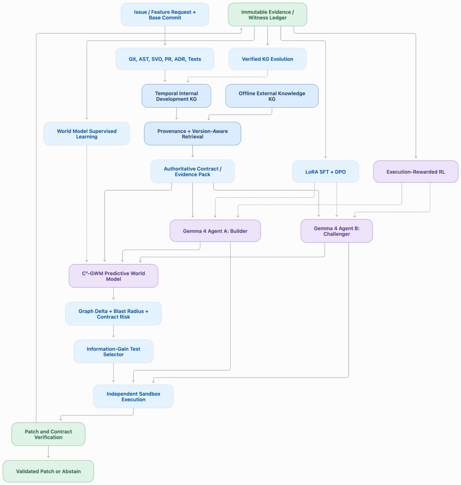

# CoEvoGraph-SWE

### Co-Evolving Knowledge Graphs and Counterfactual World Models for Repository Repair

*Version-aware contract reasoning, competitive Gemma 4 agents, and execution-verified policy learning on NVIDIA DGX Spark*

**Senthilkumar Vijayakumar, Sidharth E**

*Gemma 4 Developer Agent Paper Track*

---

## Abstract

A coding agent can edit the right function and still break the contract that governed that version of the repository. The difficulty is often less about finding the code than about knowing which requirement was authoritative when the code was written. CoEvoGraph-SWE is an offline-first Gemma 4 system built around that question. It combines a provenance-scoped development knowledge graph, version-gated external documentation, a Contract-Conditioned Counterfactual Graph World Model (C³-GWM), protected execution, and an evidence ledger that feeds supervised fine-tuning and execution-rewarded reinforcement learning.

## Problem statement

Consider two revisions of an authentication service. An earlier architecture decision, ADR-010 (2026-02-02), expires access tokens after 120 seconds. A later one, ADR-021 (2026-05-18), revises that to 40 seconds and makes the boundary exclusive. Both keep the invariant that signatures must always be verified. The bug report reads almost the same in both versions.

> A retrieval system that returns the newest or the most similar decision can produce valid Python that implements the wrong rule.

## Motivation

The call graph tells you where the behavior lives, and the revision history tells you which behavior is correct. A patch needs both to be judged.

Repair benchmarks show one repository state and ask whether a patch passes. Here the historical cutoff is part of the task definition, so the two contract versions are evaluated as one paired unit: the agent has to change its answer when the governing decision changes and keep the shared invariant while it does. We ask three questions.

- **RQ1.** Does version-valid evidence improve contract-correct repair?
- **RQ2.** Can a world model predict, before execution, which patch honours the contract in force?
- **RQ3.** Can verified outcomes flow back into the agent, through witness memory and a LoRA trained on verified edits, on the same device?

## Architecture

*Reference architecture. Blue boxes are deterministic components, purple boxes are learned or LLM components, green boxes are records and verdicts.*

An issue and a base commit enter the evidence layer. Git history, syntax trees, dated decision records and tests populate a time-versioned graph, and retrieval returns only records valid at the task date, with superseded records flagged. The Gemma 4 agent reads that evidence pack through SEARCH and VIEW tools and proposes a SEARCH/REPLACE edit. The edit runs in a sandbox on a pristine checkout, and trusted oracle files are overlaid after the patch. A world model predicts, before execution, whether the patch will satisfy the contract in force. Verified outcomes feed witness memory, adapter training and the world model, and held-out families never enter any of them.

| Layer | Role | Code |
|:-|:-|:-|
| Evidence | Time-versioned graph, time-valid retrieval, offline documentation gate | `coevo/kg.py`, `retrieval.py`, `extdocs.py` |
| Agent | Gemma 4 12B, tool loop, SEARCH/REPLACE edit format | `coevo/agent.py` |
| Verifier | Fresh checkout, oracle overlay, resource limits | `coevo/tasks.py`, `sandbox.py` |
| World model | C³-GWM predicts patch success before execution | `coevo/worldmodel*.py`, `wm_eval.py` |
| Learning | Verified-witness memory, LoRA SFT, execution-rewarded RL | `coevo/b10.py`, `train.py`, `pipeline_*.py` |

The reference architecture also contains a Builder/Challenger escalation path. Its modules ship in the repository (`coevo/dual.py`, `probes.py`, `controller.py`), and the notebook concentrates on the layers in the table.

Evaluation uses **Paired Temporal-Contract Interventions**: a pair counts only when both the historical and the revised version of a requirement are repaired correctly, scored by the Paired Contract Success Rate (PCSR). Serving, verification, world-model fitting and LoRA training all run on a single DGX Spark (Gemma 4 12B-it, vLLM, FP8 weights and FP8 KV cache, NVIDIA GB10).

## A glimpse of the results

All numbers are from the paper and `results_tables.md`.

| | Finding |
|---|---|
| **RQ1** | On 240 synthetic pairs in 20 families, time-valid evidence reaches a PCSR of **0.735** on 15 held-out families, against **0.114** for a time-agnostic index (clustered difference +0.621, 95% CI 0.469 to 0.759). |
| | Swapping the validity flags drops PCSR to **0.111** on the first held-out set, so the agent acts on the validity markers it is shown. |
| **RQ2** | A contract-conditioned predictor almost doubles the AUPRC for predicting patch resolution before execution, from **0.217 to 0.410** over 6,480 executed interventions; a shuffled-contract control falls to **0.131**. |
| | Choosing one of eight executed candidates, it finds a resolving patch **0.501** of the time against 0.157 for a random pick. |
| **RQ3** | Verified-witness memory lifts the version-1 resolve rate from **0.853 to 0.907**. |
| | A LoRA adapter trained on verified edits takes strict pass@1 from **0.614 to 0.864** and cuts the mean rollout wall time from about **115 s to 20 s**. |
| | One round of execution-rewarded RL raises PCSR over the DPO checkpoint by **0.278** (95% CI 0.044 to 0.600). |
| **Hardware** | FP8 weights with an FP8 KV cache decode at **860.9 tokens/s** against 452.3 for bf16 (**1.90 times**). |

## Repository

| Folder | Contents |
|---|---|
| [`1_paper_and_notebook/`](1_paper_and_notebook) | The paper writeup, the notebook that regenerates every table, and `results_tables.md`. |
| [`2_contractbench/`](2_contractbench) | ContractBench: the released benchmark. |
| [`3_contractgate/`](3_contractgate) | ContractGate: the released scorer. |

## References

References cited in the paper.

1. Jimenez et al. SWE-bench: Can language models resolve real-world GitHub issues? ICLR 2024.
2. Ouyang et al. RepoGraph: Enhancing AI software engineering with repository-level code graph. ICLR 2025.
3. Tao et al. Code Graph Model (CGM): a graph-integrated LLM for repository-level software engineering tasks. NeurIPS 2025.
4. Su et al. Software World Models: from consequence prediction to decision value. arXiv:2610.04940, 2026.
5. Pu, Tang, Zhang. COUNTERMEM: world-model verified counter-factual memory for language agents. arXiv:2609.31874, 2026.
6. Zhou et al. A unified issue resolution benchmark for requirement clarification, planning, and code generation (SWE-RPG). arXiv:2608.09072, 2026.
7. Ma et al. SWE-Proof: can language models resolve real-world issues with machine-checked proofs? arXiv:2609.21190, 2026.
8. Wei et al. Toward training superintelligent software agents through self-play SWE-RL. ICML 2026 (PMLR 306).
9. Choi et al. Anchored self-play for code repair. ICML 2026 (PMLR 306).
10. Ma et al. Scaling agentic verifier for competitive coding. ICML 2026 (PMLR 306).
11. Hu et al. LoRA: low-rank adaptation of large language models. ICLR 2022.
12. Rafailov et al. Direct preference optimization. NeurIPS 2023.
13. Shao et al. DeepSeekMath (introduces GRPO). arXiv:2402.03300, 2024.
14. Kwon et al. Efficient memory management for LLM serving with PagedAttention (vLLM). SOSP 2023.
15. Google DeepMind. Gemma 4 technical report. arXiv:2607.02770, 2026.

## Citation and license

Code and the notebook are released under the [Apache License 2.0](LICENSE) with third-party notices. Cite using [`CITATION.cff`](CITATION.cff).
