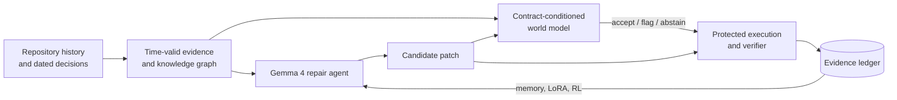

# CoEvoGraph-SWE

### Teaching code agents to ask: *which rule was in force?*

**Time-aware contract reasoning for repository repair, with Gemma 4 agents that learn from execution, all on a single NVIDIA DGX Spark.**

---

## Abstract

Requirements change over time, and a patch that is correct for yesterday's rule can be wrong for today's. CoEvoGraph-SWE is an offline-first Gemma 4 system that gives a repair agent a sense of *time*: it reads the repository's dated design decisions, works out which one governed the code at that moment, and uses a contract-conditioned world model to judge a patch before running it. Verified outcomes then flow back into the agent through memory and on-device fine-tuning, so the system improves from its own checked results.

The release includes the paper with a runnable notebook, **ContractBench** (a benchmark for contract-following) and **ContractGate** (a pre-execution patch checker).

## The problem

> A bug report can read the same in two versions of a project, while the correct fix is different in each.

An authentication service first expires tokens after 120 seconds. A later design decision changes that to 40. Same code, same bug report, two right answers. Agents that retrieve the *newest* or the *most similar* document can write clean, passing-looking code for the wrong rule.

## Why it matters

Real software is governed by decisions that get revised, superseded and forgotten. Today's repair benchmarks show a single snapshot and ask only "do the tests pass?". They cannot tell whether an agent understood **which requirement applied**, and that is the question teams care about when a fix ships. We wanted a way to measure it, a way to improve it, and a way to catch the mistake before any test is run.

## Architecture

**Evidence** is filtered by date, so the agent sees only what was true at the time. A **world model** predicts whether a patch honours the contract in force. A **tamper-resistant verifier** executes patches and records what really happened. That **ledger** teaches the agent through memory, fine-tuning and execution-rewarded reinforcement learning.

## A glimpse of the results

| | |
|---|---|
| **Right rule, right fix** | Success on paired contract tasks rises from **0.11** to **0.74** when the agent sees time-valid evidence instead of a time-agnostic index. |
| **Predict before you run** | The world model roughly doubles the ability to spot a correct patch before any test executes. |
| **Learns on-device** | Fine-tuning on verified edits lifts strict pass@1 from **0.61** to **0.86** and cuts rollout time from about 115 s to 20 s. |
| **One box** | Serving, verification, modelling and training all run on one DGX Spark. |

Full tables, controls and confidence intervals are in [`results_tables.md`](1_paper_and_notebook/results_tables.md).

## What's inside

| | |
|---|---|
| [`1_paper_and_notebook/`](1_paper_and_notebook) | The paper and the notebook that reproduces it end to end. |
| [`2_contractbench/`](2_contractbench) | **ContractBench**: paired, execution-verified tasks that test whether an agent follows the contract in force. |
| [`3_contractgate/`](3_contractgate) | **ContractGate**: scores a patch as accept, flag or abstain before tests run. |

## Citation and license

Released under the [Apache License 2.0](LICENSE). If this work is useful to you, please cite it using [`CITATION.cff`](CITATION.cff).
